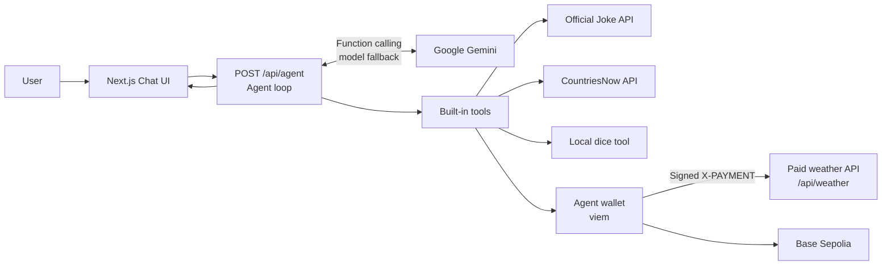
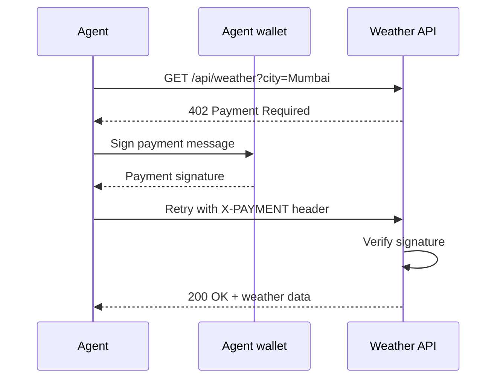

# PayPilot

### An AI agent that selects tools, pays for APIs, and keeps working

[](https://nextjs.org/)
[](https://www.typescriptlang.org/)
[](https://ai.google.dev/)
[](https://viem.sh/)
[](LICENSE)

PayPilot is an autonomous AI agent powered by Google Gemini. It chooses the right tool for each question and can pay a paid API from its own crypto wallet using the x402 pay-per-request pattern.

**Live demo:** [agentmax1.netlify.app](https://agentmax1.netlify.app/)<br />
**Source code:** [github.com/s-m-monika/midnightL1](https://github.com/s-m-monika/midnightL1)

---

## Table of Contents

1. [About the Project](#1-about-the-project)
2. [Features](#2-features)
3. [Tech Stack](#3-tech-stack)
4. [Installation](#4-installation)
5. [Usage](#5-usage)
6. [Environment Variables](#6-environment-variables)
7. [Project Structure](#7-project-structure)
8. [Future Improvements](#8-future-improvements)
9. [Team Members](#9-team-members)
10. [Contributing](#10-contributing)
11. [License](#11-license)

---

## 1. About the Project

AI agents become more useful when they can access real services, but paid APIs traditionally require a person to create accounts, manage subscriptions, and provide API keys. PayPilot gives the agent its own testnet wallet so it can respond to an HTTP `402 Payment Required` response, sign a payment, and retry the request automatically.

This demonstrates a practical path toward pay-per-use agent systems while keeping the payment flow transparent and non-custodial for the demo. No real money moves: payments are signed messages verified by the API, not on-chain transactions.

## 2. Features

- **Autonomous tool use** — Gemini reads tool descriptions and can chain up to five tool calls to answer a single question.
- **Agent-owned wallet** — Create a wallet on the Base Sepolia testnet directly from the Setup panel.
- **x402 payments** — The weather API requires a signed `0.01 USDC` payment before returning data; the agent handles the full 402 → sign → retry loop on its own.
- **Five built-in tools:**
  - `get_weather` — paid weather lookup for any city
  - `get_my_wallet` — shows the agent's wallet address and balance
  - `roll_dice` — rolls a die with any number of sides
  - `get_joke` — fetches a joke from the Official Joke API
  - `get_country_info` — returns a country's capital and population
- **Automatic model fallback** — switches to another Gemini model when the preferred one returns a `404`, `429`, or `503`, and remembers the working model.
- **Transparent execution** — expandable tool cards show each tool's input, output, and payment receipt.
- **Conversation memory** — continue asking follow-up questions in the same chat.
- **Hosting-ready API route** — consistent JSON errors and a 60-second agent execution window.
- **Easy to extend** — add a new tool by defining a single object in `agent/tools.ts`.

## 3. Tech Stack

| Category | Technology |
| --- | --- |
| Language | TypeScript |
| Framework | Next.js 16 (App Router, API routes) |
| UI | React 19, Tailwind CSS 4, Base UI, shadcn/ui, Lucide icons |
| AI | Google Gemini via `@google/genai` function calling |
| Blockchain | viem on Base Sepolia testnet |
| Payment protocol | x402-style HTTP `402 Payment Required` + signed `X-PAYMENT` headers |
| External APIs | Official Joke API, CountriesNow |
| Hosting | Netlify |
| Tooling | Node.js 20+, npm, Git, GitHub |

## 4. Installation

### Prerequisites

- Node.js 20 or newer
- npm
- A Gemini API key from [Google AI Studio](https://aistudio.google.com/apikey)

### Steps

```bash
git clone https://github.com/s-m-monika/midnightL1.git
cd midnightL1
npm install
```

Create your environment file:

```bash
# macOS/Linux
cp .env.example .env

# Windows PowerShell
Copy-Item .env.example .env
```

Add your Gemini API key to `.env` (see [Environment Variables](#6-environment-variables)).

Start the development server:

```bash
npm run dev
```

Open [http://localhost:3000](http://localhost:3000), click **Create wallet** in the Setup panel, and start chatting.

### Production build

```bash
npm run build
npm run start
```

### Deploy to Netlify

1. Import the repository at [netlify.com](https://www.netlify.com/).
2. Add `GEMINI_API_KEY`, `GEMINI_MODEL`, and `WALLET_PRIVATE_KEY` under **Site configuration → Environment variables**.
3. Deploy the site.

> Never commit `.env` or `.agent-wallet.json`. Use test wallets and testnet funds only.

## 5. Usage

Try the live application at **[agentmax1.netlify.app](https://agentmax1.netlify.app/)**.

| Prompt | Expected behavior |
| --- | --- |
| "What's the weather in Mumbai?" | Pays `0.01 USDC` through the demo flow and returns weather data. |
| "What's in your wallet?" | Shows the agent's wallet address and balance. |
| "Roll a 20-sided dice." | Calls the local dice tool. |
| "Tell me a joke." | Fetches a joke from the Official Joke API. |
| "What's the capital of India?" | Returns country information, including capital and population. |

Each tool call appears as an expandable card in the chat. Paid calls include a **PAID 0.01 USDC** badge and a payment receipt.

### How it works

1. The user submits a message from the chat UI to `/api/agent`.
2. The agent sends the conversation and tool definitions to Gemini.
3. Gemini either returns a final response or requests a tool call.
4. PayPilot executes the tool and sends the result back to Gemini (up to five rounds).
5. When the paid weather API returns `402 Payment Required`, the agent's wallet signs the requested payment.
6. PayPilot retries the request with an `X-PAYMENT` header.
7. The API verifies the signature and returns the result.
8. The UI renders the final answer, tool inputs, outputs, and payment details.





## 6. Environment Variables

| Variable | Required | Description |
| --- | :---: | --- |
| `GEMINI_API_KEY` | Yes | API key used to access Google Gemini. |
| `GEMINI_MODEL` | No | Preferred Gemini model. Defaults to `gemini-flash-lite-latest`; automatic fallback remains enabled. |
| `WALLET_PRIVATE_KEY` | No | Existing test wallet private key: `0x` + 64 hexadecimal characters. Use a **test** wallet only. |

On hosted platforms with a read-only filesystem, set `WALLET_PRIVATE_KEY` so the wallet survives redeploys and cold starts.

## 7. Project Structure

```
midnightL1/
├── agent/
│   ├── agent.ts        # Agent loop: Gemini calls, tool execution, model fallback
│   ├── tools.ts        # Tool definitions (add your own tools here)
│   └── wallet.ts       # Wallet creation, balances, x402 sign & verify
├── app/
│   ├── api/
│   │   ├── agent/route.ts   # Chat endpoint running the agent loop
│   │   └── weather/route.ts # Mock paid API (402 → verify payment → data)
│   ├── globals.css
│   ├── layout.tsx
│   └── page.tsx             # Chat UI + Setup panel
├── components/
│   └── ui/                  # shadcn/ui primitives
├── lib/
│   └── utils.ts
├── public/
├── .env.example             # Template for environment variables
├── next.config.ts
└── package.json
```

## 8. Future Improvements

- **Real on-chain settlements** — submit x402 payments as actual USDC transactions on Base Sepolia instead of signature-only verification.
- **Persistent chat history** — store conversations in a database (e.g. Postgres or SQLite) instead of keeping them in memory.
- **Wallet persistence on serverless hosts** — replace the temp-folder fallback with encrypted key storage or a managed wallet service.
- **More tools** — news lookup, web search, file handling, and calendar integrations.
- **Streaming responses** — stream agent answers token-by-token for a faster feel.
- **Multi-user support** — per-user wallets and rate limiting for public deployments.
- **Agent observability** — a dashboard for tool-call latency, payment totals, and model fallbacks.
- **Unit and integration tests** — cover the payment flow, wallet logic, and agent loop.

## 9. Team Members

| Name | Role | GitHub |
| --- | --- | --- |
| **Monika** | Developer | [@s-m-monika](https://github.com/s-m-monika) |

## 10. Contributing

Contributions are welcome!

1. Fork the repository.
2. Create a feature branch: `git checkout -b feature/your-feature-name`
3. Commit your changes: `git commit -m "Add your feature"`
4. Push the branch: `git push origin feature/your-feature-name`
5. Open a Pull Request describing your changes.

Please keep PRs focused, follow the existing code style, and make sure `npm run build` passes before submitting.

## 11. License

This project is licensed under the [MIT License](LICENSE).

Built on the [agentmaxxin starter kit](https://www.npmjs.com/package/agentmaxxin).

Created by **[Monika](https://github.com/s-m-monika)** · [@s-m-monika](https://github.com/s-m-monika)
