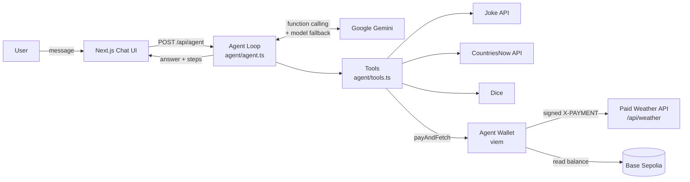
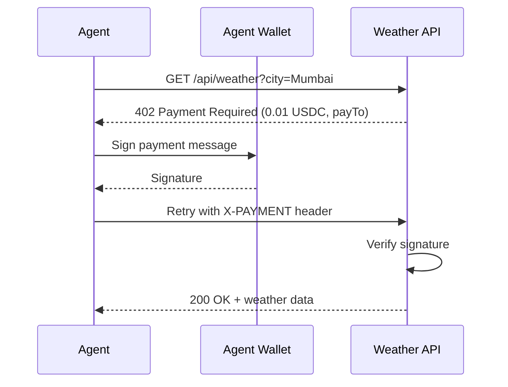

# PayPilot: The AI Agent That Pays for Its Own APIs

An autonomous AI agent, powered by Google Gemini, that picks the right tools for each question and pays for paid APIs by itself from its own crypto wallet.


---

## 1. About the Project

AI agents get more useful when they can call real services, but many valuable APIs are paid, and today a human has to set up accounts, subscriptions and API keys for each one. **PayPilot** gives the agent its own wallet. When an API answers `402 Payment Required`, the agent signs a payment on its own and retries, following the **x402 pay-per-request** pattern, so the agent pays only for what it uses. Automatic Gemini model fallback keeps the agent running even when a model is retired, rate-limited or overloaded.

---

## 2. Features

- **Autonomous tool use:** Gemini reads each tool's description and decides when to call it, chaining up to 5 tool calls per answer.
- **Agent-owned crypto wallet:** one click creates a wallet on Base Sepolia (testnet) that the agent uses to sign payments.
- **x402 pay-per-request:** a mock paid weather API refuses requests until the agent pays 0.01 USDC with a signed payment.
- **Five built-in tools:**
  - `get_weather`: weather for any city (paid API).
  - `get_my_wallet`: the agent's wallet address and balance.
  - `roll_dice`: a dice with any number of sides.
  - `get_joke`: a random joke from a public API.
  - `get_country_info`: a country's capital and population.
- **Automatic model fallback:** if a Gemini model fails with a 404, 429 or 503, the agent switches to the next available model and remembers the one that worked.
- **Transparent chat UI:** every tool call shows its input, output and payment receipt, so you can expand each one.
- **Conversation memory:** you can ask follow-up questions in the same chat.
- **Works when hosted:** the app handles read-only serverless file systems, always returns JSON errors, and gives the agent route a 60-second time limit.
- **Easy to extend:** a new tool is one object in `agent/tools.ts`.

---

## 3. Tech Stack

| Category | Technologies |
| :--- | :--- |
| **Language** | TypeScript |
| **Framework** | Next.js 16 (App Router + API routes), React 19 |
| **AI** | Google Gemini via the Google Gen AI SDK (`@google/genai`), using function calling |
| **Blockchain / Wallet** | viem: wallet creation, message signing, signature verification, Base Sepolia testnet |
| **Payments pattern** | x402 (HTTP `402 Payment Required` + signed `X-PAYMENT` header) |
| **UI** | Tailwind CSS 4, shadcn/ui, Base UI, Lucide icons |
| **External APIs** | [Official Joke API](https://official-joke-api.appspot.com), [CountriesNow](https://countriesnow.space) |
| **Hosting** | Vercel |
| **Tools** | Node.js 20+, npm, Git, GitHub |
| **Database** | None. The wallet is stored in a local JSON file or an environment variable. |

---

## 4. Installation and Setup

### Prerequisites

- [Node.js](https://nodejs.org) 20 or newer (check with `node -v`)
- A free Gemini API key from [Google AI Studio](https://aistudio.google.com/apikey)

### Steps

```bash
# 1. Clone the repository
git clone https://github.com/s-m-monika/my-agent.git
cd my-agent

# 2. Install dependencies
npm install

# 3. Create your environment file
cp .env.example .env
# Windows PowerShell: Copy-Item .env.example .env
```

Open `.env` and add your Gemini key:

```bash
GEMINI_API_KEY=your_key_here
GEMINI_MODEL=gemini-flash-lite-latest
```

```bash
# 4. Start the app
npm run dev
```

Open **http://localhost:3000**, click **Create wallet** in the Setup panel, and start chatting.

### Environment variables

| Variable | Required | Description |
| :--- | :---: | :--- |
| `GEMINI_API_KEY` | Yes | Your Gemini API key. |
| `GEMINI_MODEL` | No | Preferred model (default `gemini-flash-lite-latest`). The agent falls back to other models automatically. |
| `WALLET_PRIVATE_KEY` | No | An existing test wallet's private key (`0x` + 64 hex characters, not the address). Recommended on hosts like Vercel. |

### Deploy to Vercel

1. Import the GitHub repo on [vercel.com](https://vercel.com).
2. Add `GEMINI_API_KEY`, `GEMINI_MODEL` and `WALLET_PRIVATE_KEY` under **Settings > Environment Variables**.
3. Click **Deploy**.

> `.env` and `.agent-wallet.json` are in `.gitignore` and are never committed. Use test wallets only.

---

## 5. Screenshots or Demo

**Source code:** [github.com/s-m-monika/my-agent](https://github.com/s-m-monika/my-agent)

### Sample run (real output)

**Prompt:** `What's the weather in Mumbai?`

```json
{
  "answer": "The weather in Mumbai is sunny with a temperature of 30°C!",
  "steps": [
    {
      "tool": "get_weather",
      "args": { "city": "Mumbai" },
      "result": {
        "data": { "city": "Mumbai", "temperatureC": 30, "condition": "Sunny", "paidBy": "0x5d07...AAe4" },
        "payment": { "status": 200, "amount": "0.01 USDC", "to": "0x0000...dEaD", "signature": "0x687ba0402a6340a6..." }
      }
    }
  ]
}
```

**Prompt:** `Capital of USA?`

```json
{
  "answer": "The capital of the USA is Washington, D.C.",
  "steps": [
    {
      "tool": "get_country_info",
      "args": { "country": "United States" },
      "result": { "country": "United States", "capital": "Washington", "population": 326687501, "populationYear": 2018 }
    }
  ]
}
```

In the app, each step appears as an expandable tool card. Paid calls get a **PAID 0.01 USDC** badge.

### Try these prompts

| Prompt | What happens |
| :--- | :--- |
| `What's the weather in Mumbai?` | The agent pays 0.01 USDC and returns the weather. |
| `What's in your wallet?` | Shows the agent's address and balance. |
| `Roll a 20 sided dice` | Calls a simple local tool. |
| `Tell me a joke` | Fetches a random joke. |
| `What's the capital of India?` | Returns the capital and population. |

---

## 6. How It Works

### Workflow

1. The **user** sends a message from the chat UI to `/api/agent`.
2. The **agent loop** sends the conversation and the tool list to **Gemini**. If the model is unavailable, it falls back to the next one.
3. If Gemini requests a tool, the agent runs it and sends the result back. This repeats until Gemini replies with text (up to 5 rounds).
4. For a **paid API**, the first request returns `402 Payment Required` with a price.
5. The **agent wallet** signs a payment, and the request is retried with an `X-PAYMENT` header.
6. The API **verifies the signature** and returns `200 OK` with the data.
7. The UI shows the final answer along with every tool call and payment receipt.

### Architecture



### x402 Payment Flow



> Payments are cryptographically signed but not submitted on-chain, so no real money moves. This is a testnet demo.

---

## Author

**Monika** · [@s-m-monika](https://github.com/s-m-monika)

Built on the [agentmaxxin](https://www.npmjs.com/package/agentmaxxin) starter kit. Licensed under [MIT](LICENSE).
