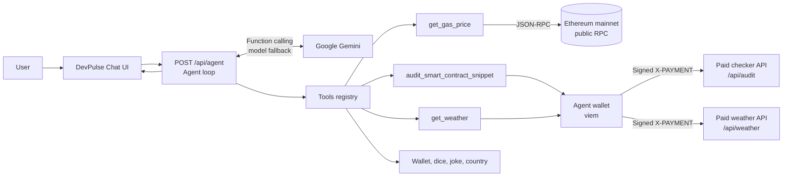
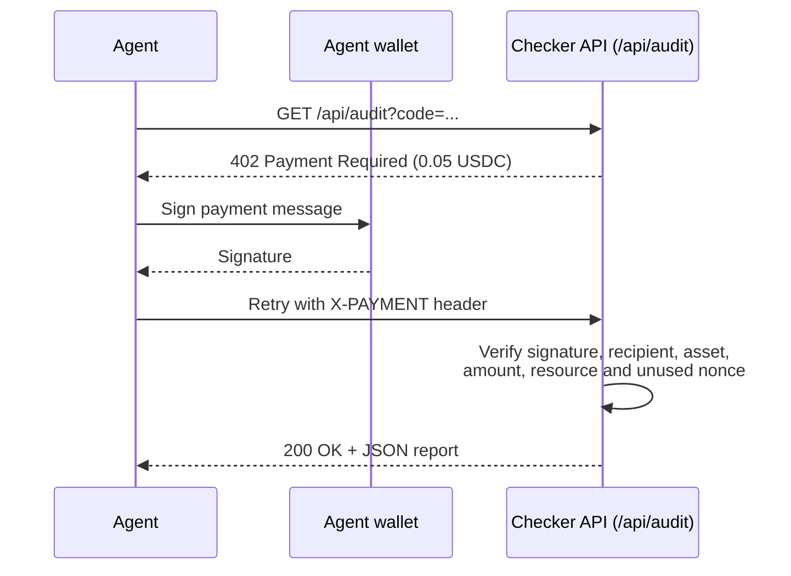

# DevPulse

### An AI Web3 developer assistant that checks live gas, reviews Solidity, and pays for APIs on its own

[](https://nextjs.org/)
[](https://www.typescriptlang.org/)
[](https://ai.google.dev/)
[](https://viem.sh/)
[](LICENSE)

DevPulse is an autonomous AI agent powered by Google Gemini, built for Web3 developers. You chat with it in plain English: it reads **live Ethereum gas data**, checks **Solidity code for common risky patterns**, explains the results in beginner-friendly language, and pays for protected APIs from **its own wallet** using the x402 pay-per-request pattern.

**Live demo:** https://devpulse-week2.netlify.app/ <br />


---

## Table of Contents

1. [About the Project](#1-about-the-project)
2. [What's New in Week 2](#2-whats-new-in-week-2)
3. [Features](#3-features)
4. [Tech Stack](#4-tech-stack)
5. [Installation](#5-installation)
6. [Usage](#6-usage)
7. [How It Works](#7-how-it-works)
8. [Environment Variables](#8-environment-variables)
9. [Project Structure](#9-project-structure)
10. [Testing](#10-testing)
11. [Limitations](#11-limitations)
12. [Future Improvements](#12-future-improvements)
13. [Team Members](#13-team-members)
14. [Contributing](#14-contributing)
15. [License](#15-license)

---

## 1. About the Project

Web3 developers constantly switch between gas trackers, block explorers and security checklists, and paid developer APIs usually need a person to set up accounts and API keys. DevPulse puts these tasks in one chat. The agent picks the right tool for each question, and when an API answers `402 Payment Required`, it signs a payment with its own testnet wallet and retries, so it pays only for what it uses.

No real money moves: payments are signed messages verified by the API, not on-chain transactions.

## 2. What's New in Week 2

Week 1 built the agent ("PayPilot"): a Gemini agent loop, an agent-owned wallet, an x402 paid weather API, and general-purpose tools. Week 2 turns it into **DevPulse**, a Web3 developer assistant:

| Area | Week 2 change |
| --- | --- |
| **Live gas tracker** | New free tool `get_gas_price` that reads live Ethereum mainnet gas data over public JSON-RPC (no API key). |
| **Smart contract checker** | New paid tool `audit_smart_contract_snippet` and endpoint `GET /api/audit` that flag risky Solidity patterns for `0.05 USDC`. |
| **Hardened payment checks** | The audit endpoint also checks the recipient, asset, amount, **resource** and **nonce**, so payments can't be replayed or reused from another API. |
| **Payment status in the UI** | Each paid call shows a step-by-step flow (payment required → signature generated → verification successful / failed). A rejected payment is never shown as paid. |
| **DevPulse interface** | New name and headings, feature cards, Web3 sample prompts, and a multi-line input so pasted Solidity keeps its line breaks. |
| **Agent behaviour** | The system prompt now tells the agent to quote only real gas values, explain findings simply, and call them suspicious patterns, not confirmed vulnerabilities. |

All Week 1 tools still work and were re-tested.

## 3. Features

- **Live Ethereum gas tracker** (`get_gas_price`, free)
  - Gas price, current and next-block base fee, and low / standard / fast priority fees in gwei.
  - Estimated cost of a simple ETH transfer at each tier.
  - Block number, block timestamp, data age, data source and retrieval time.
  - Tries several public RPC endpoints in turn. If they all fail, it says the data could not be retrieved; it never invents or caches values.
- **Smart contract checker** (`audit_smart_contract_snippet`, `0.05 USDC`)
  - Flags `tx.origin` used for authorization.
  - Flags low-level calls (`.call`, `.send`, `.delegatecall`, `.staticcall`) and whether their return value is checked.
  - Flags potential reentrancy (contract state updated after an external call), and recognises `nonReentrant` guards.
  - Flags every `delegatecall` for review.
  - Returns a JSON report with a summary, findings (severity, title, lines, explanation, fix), the checks performed, and a disclaimer.
  - Ignores comments and strings to reduce false positives. The code is analysed as text and is never compiled or executed.
- **x402 pay-per-request payments:** paid APIs answer `402`, the agent signs a payment and retries with an `X-PAYMENT` header, and the API verifies it before returning data.
- **Agent-owned wallet:** create a Base Sepolia testnet wallet from the Setup panel.
- **Autonomous tool use:** Gemini reads tool descriptions and can chain up to five tool calls per answer.
- **Automatic model fallback:** switches Gemini models on `404`, `429` or `503` errors and remembers the one that worked.
- **Transparent chat:** expandable tool cards show each tool's input, output and payment flow.
- **Week 1 tools kept:** `get_weather` (paid), `get_my_wallet`, `roll_dice`, `get_joke`, `get_country_info`.
- **Responsive:** works on desktop and mobile.

## 4. Tech Stack

| Category | Technology |
| --- | --- |
| Language | TypeScript |
| Framework | Next.js 16 (App Router, Route Handlers) |
| UI | React 19, Tailwind CSS 4, Base UI, shadcn/ui, Lucide icons |
| AI | Google Gemini via `@google/genai` function calling |
| Blockchain | viem: Ethereum mainnet reads (gas) and Base Sepolia testnet (wallet) |
| Gas data | Public Ethereum JSON-RPC endpoints (`eth_gasPrice`, `eth_getBlockByNumber`, `eth_feeHistory`) via dRPC, 1RPC and PublicNode |
| Payment protocol | x402-style HTTP `402 Payment Required` + signed `X-PAYMENT` headers |
| External APIs | Open-Meteo (weather), Official Joke API, CountriesNow |
| Hosting | Netlify |
| Tooling | Node.js 20+, npm, Git, GitHub |

No new npm dependencies were added in Week 2.

## 5. Installation

### Prerequisites

- Node.js 20 or newer
- npm
- A Gemini API key from [Google AI Studio](https://aistudio.google.com/apikey). This is the **only** API key needed: the gas tracker, contract checker and other tools need no keys.

### Steps

```bash
git clone https://github.com/s-m-monika/midnightL1.git
cd midnightL1
npm install
```

Create your environment file:

```bash
# macOS/Linux
cp .env.example .env

# Windows PowerShell
Copy-Item .env.example .env
```

Add your Gemini API key to `.env` (see [Environment Variables](#8-environment-variables)), then start the development server:

```bash
npm run dev
```

Open [http://localhost:3000](http://localhost:3000), click **Create wallet** in the Setup panel, and start chatting.

### Production build

```bash
npm run build
npm run start
```

### Deploy to Netlify

1. Import the repository at [netlify.com](https://www.netlify.com/).
2. Add `GEMINI_API_KEY`, `GEMINI_MODEL` and `WALLET_PRIVATE_KEY` under **Site configuration → Environment variables**.
3. Deploy the site.

> Never commit `.env` or `.agent-wallet.json`. Use test wallets and testnet funds only.

## 6. Usage

| Prompt | Expected behavior |
| --- | --- |
| "Check the current Ethereum gas price." | Calls `get_gas_price` and reports live base fee, priority-fee tiers and transfer cost, with the block and time. |
| "Review this Solidity contract for common security issues: [paste code]" | Pays `0.05 USDC` through the demo flow, runs the checker, and explains each finding with its line and fix. |
| "Explain the difference between high and low gas prices." | Answers from general knowledge, and may fetch live gas for context. |
| "What's the weather in Mumbai?" | Pays `0.01 USDC` and returns live weather (Week 1). |
| "What's in your wallet?" | Shows the agent's wallet address and balance (Week 1). |
| "Roll a 20-sided dice." | Calls the local dice tool (Week 1). |

The contract example button fills the input with a small sample contract that contains a reentrancy bug and a `tx.origin` check, so you can try the checker straight away. Press **Enter** to send and **Shift + Enter** for a new line.

### Sample checker finding (real output)

```json
{
  "severity": "high",
  "title": "Potential reentrancy in withdraw(): state updated after external call",
  "lines": [13, 15],
  "status": "suspicious pattern - needs manual review",
  "explanation": "In withdraw(), an external call happens on line 13 and contract state is changed afterwards on line 15. While the external call runs, the receiver can call back into this function before the state update...",
  "remediation": "Follow checks-effects-interactions: update balances and other state before the external call. Add a reentrancy guard such as OpenZeppelin ReentrancyGuard (nonReentrant)..."
}
```

## 7. How It Works

1. The user sends a message from the chat UI to `/api/agent`.
2. The agent sends the conversation and tool definitions to Gemini (with model fallback).
3. Gemini either answers or asks for a tool. DevPulse runs the tool and sends the result back, up to five rounds.
4. **Free tools** like `get_gas_price` return data directly.
5. **Paid tools** call an API that first answers `402 Payment Required` with a price, asset and recipient.
6. The agent wallet signs a payment message and the request is retried with an `X-PAYMENT` header.
7. The API verifies the signature and payment terms, then returns the protected result.
8. The UI shows the answer, every tool's input and output, and the payment flow.





### Payment verification on `/api/audit`

A protected report is only returned if **all** of these pass. Otherwise the API answers `402` with a reason.

- The signature is valid for the `from` address (via the existing `verifyPayment` helper).
- The payment is addressed to the API's recipient.
- The asset is `USDC` and the amount is at least `0.05`.
- The payment was signed for `/api/audit` (a weather payment can't be reused).
- The nonce hasn't been used before (a captured payment can't be replayed).

Invalid input (empty, too long, or not Solidity) is rejected with `400` **before** payment is requested, so the agent never pays for nothing.

## 8. Environment Variables

| Variable | Required | Description |
| --- | :---: | --- |
| `GEMINI_API_KEY` | Yes | API key used to access Google Gemini. |
| `GEMINI_MODEL` | No | Preferred Gemini model. Defaults to `gemini-flash-lite-latest`; automatic fallback remains enabled. |
| `WALLET_PRIVATE_KEY` | No | Existing test wallet private key: `0x` + 64 hexadecimal characters (not the 42-character address). Use a **test** wallet only. |

No extra keys are needed for Week 2 features. On hosted platforms with a read-only filesystem, set `WALLET_PRIVATE_KEY` so the wallet survives redeploys and cold starts.

## 9. Project Structure

```
midnightL1/
├── agent/
│   ├── agent.ts        # Agent loop: Gemini calls, tool execution, model fallback
│   ├── tools.ts        # Tool registry (gas, checker, weather, wallet, dice, joke, country)
│   ├── gas.ts          # Week 2: live Ethereum gas over public JSON-RPC
│   ├── audit.ts        # Week 2: heuristic Solidity checker (never executes code)
│   └── wallet.ts       # Wallet creation, balances, x402 sign & verify
├── app/
│   ├── api/
│   │   ├── agent/route.ts    # Chat endpoint running the agent loop
│   │   ├── audit/route.ts    # Week 2: paid checker API (402 → verify payment → report)
│   │   ├── wallet/route.ts   # Creates / reads the agent wallet
│   │   └── weather/route.ts  # Paid weather API (402 → verify payment → data)
│   ├── globals.css
│   ├── layout.tsx
│   └── page.tsx              # DevPulse UI: setup, tools, chat, payment flow
├── components/
│   └── ui/                   # shadcn/ui primitives
├── lib/
│   └── utils.ts
├── public/
├── .env.example              # Template for environment variables
├── next.config.ts
└── package.json
```

## 10. Testing

These checks were run locally against a production build (`npm run build` + `npm run start`):

| Area | What was tested | Result |
| --- | --- | :---: |
| Build | `npm run build` and `tsc --noEmit` | ✅ |
| Gas tool | Live response from Ethereum mainnet (gwei metrics, block, source, time) | ✅ |
| Gas tool | Simulated network failure, HTTP `429` rate limit, and invalid response all report "could not be retrieved" | ✅ |
| Checker | Safe contract: no high/medium/low findings | ✅ |
| Checker | Vulnerable code: reentrancy, `tx.origin` auth, unchecked `.send` / `.delegatecall`, `delegatecall` all flagged | ✅ |
| Checker | `nonReentrant` downgrades reentrancy; comments and strings ignored; bad input rejected | ✅ |
| Payments | No payment, malformed header, forged signature, wrong signer, edited amount → `402` | ✅ |
| Payments | Underpaid, wrong recipient, wrong asset, weather payment reused, replayed nonce → `402` | ✅ |
| Payments | Valid signed payment → `200` with report | ✅ |
| Agent | Gemini picks `get_gas_price`, `audit_smart_contract_snippet` (payment verified) and `roll_dice` from natural-language prompts | ✅ |
| Week 1 | Wallet endpoint and paid weather API still work | ✅ |

## 11. Limitations

- **Not a security audit.** The checker uses pattern matching, not compilation or data-flow analysis. It can miss real issues and flag safe code. Use tools like Slither, Foundry tests and a professional audit before deploying contracts that hold value.
- **Code size.** Code is sent in the request URL to reuse the existing `payAndFetch` helper (GET only), so snippets are limited to 4,000 characters.
- **Demo payments.** Payments are signed messages, not on-chain transfers. Any wallet that signs a correct payment is accepted, and wallet balances aren't checked.
- **Replay protection is in memory.** Used nonces reset on restart and aren't shared across serverless instances.
- **Public RPC endpoints** can be slow, rate-limited or blocked on some networks. DevPulse tries several in turn and reports clearly when all fail.
- **Gemini may reformat pasted code** before passing it to the checker, which can shift reported line numbers slightly.

## 12. Future Improvements

- **Real on-chain settlement:** submit x402 payments as actual USDC transactions on Base Sepolia.
- **Deeper analysis:** integrate Slither or solc AST parsing for more accurate findings.
- **POST support in `payAndFetch`:** allow larger contracts in the request body.
- **Shared nonce store:** a database or KV store for replay protection across instances.
- **More Web3 tools:** token prices, transaction decoding, ABI lookup and contract verification status.
- **Gas history charts** and alerts for low-fee windows.
- **Streaming responses** and **persistent chat history**.

## 13. Team Members

| Name | Role | GitHub |
| --- | --- | --- |
| **Monika** | Developer | [@s-m-monika](https://github.com/s-m-monika) |

## 14. Contributing

Contributions are welcome!

1. Fork the repository.
2. Create a feature branch: `git checkout -b feature/your-feature-name`
3. Commit your changes: `git commit -m "Add your feature"`
4. Push the branch: `git push origin feature/your-feature-name`
5. Open a Pull Request describing your changes.

Please keep PRs focused, follow the existing code style, and make sure `npm run build` passes before submitting.

## 15. License

This project is licensed under the [MIT License](LICENSE).

Built on the [agentmaxxin starter kit](https://www.npmjs.com/package/agentmaxxin).

Created by **[Monika](https://github.com/s-m-monika)** · [@s-m-monika](https://github.com/s-m-monika)
